  

  
  

Analista de Sistemas Pleno na kie-tec, com pós-graduação em Machine Learning e Inteligência Artificial. Desenvolvo software com Python e TypeScript, utilizando modelos de linguagem (LLM) como aceleradores do ciclo de desenvolvimento, e atuo no desenvolvimento, análise e sustentação de automações RPA em UiPath.

## // Atuação atual

- Desenvolvimento, análise e sustentação de automações (RPA) em UiPath para clientes de setores como indústria e financeiro.
- Participação no desenvolvimento de um motor de inteligência artificial voltado à análise e verificação de documentos.
- Frente interna dedicada a incorporar ferramentas de LLM às etapas de levantamento, desenvolvimento, análise e testes de software.

## // Tecnologias

  

**Inteligência artificial**

  
  
  
  
  
  
  
  
  
  
  

**Automação e testes**

  
  
  
  
  

## // IA aplicada: o que venho estudando e testando

### Desenvolvimento assistido por agentes

- **Spec-Driven Development** com Spec Kit e tlc-spec-lean: plano, checks, construção e verificação por um agente independente, com validadores automáticos.
- **Custo de orquestração de múltiplos agentes**: medição de tokens por etapa do fluxo. A troca de agente no meio da construção saiu 32% mais cara, e a correção feita por um agente novo custou 2,6 vezes mais do que quando volta para quem escreveu o código.
- **Harness template** para Claude Code, Cursor e Windsurf: skills, hooks de economia de contexto e servidores MCP prontos para iniciar um projeto novo.
- **Executor de roteiros de teste**: skill que aplica um plano de testes em `.docx` contra uma aplicação web real via Playwright MCP, gerando a cópia preenchida, evidências em screenshot e o resumo de bugs.

### Modelos locais

- **Local AI Hub**: dashboard que detecta o hardware da máquina (GPU, VRAM, RAM) e recomenda modelos e backends compatíveis (Ollama, llama.cpp com Vulkan, DirectML).
- **Plataforma de IAs locais com RAG**: gerenciamento de contextos e consulta a documentos com Ollama, ChromaDB, LangChain e Streamlit.
- **Model Router**: camada de orquestração que escolhe entre Claude, OpenAI, Gemini e modelos locais de acordo com o tipo de tarefa, o custo, o contexto e a disponibilidade.
- **Second Brain CLI**: agente local de memória e prioridades acionado em linguagem natural pelo terminal, sem que nenhum dado saia da máquina.

### Aplicações com LLM

- **Checa**: verificação de fatos a partir de um link, texto ou print, com veredito por afirmação e fontes visíveis (Next.js, PostgreSQL, API da Anthropic).
- **Sinal**: sales intelligence para uma agência local, com descoberta de leads a partir de dados abertos, score explicável e diagnóstico comercial gerado sob demanda (FastAPI, React).
- **Gerador de atas de reunião**: transforma transcrições em atas `.docx` no template oficial, com suporte a Anthropic, OpenAI, Gemini e Ollama.
- **Serinus**: sistema de balcão para uma gráfica (cadastros, orçamentos e pedidos), desenvolvido inteiramente com fluxo spec-driven e agentes.
- **Polymarket AI Trader**: experimento de análise de mercados de predição com múltiplos provedores de LLM e modo de simulação (dry-run).

## // Formação

- MBA em Machine Learning e Inteligência Artificial, XP Educação (2022)
- Análise e Desenvolvimento de Sistemas, IFPR Paranaguá (2016–2019)

